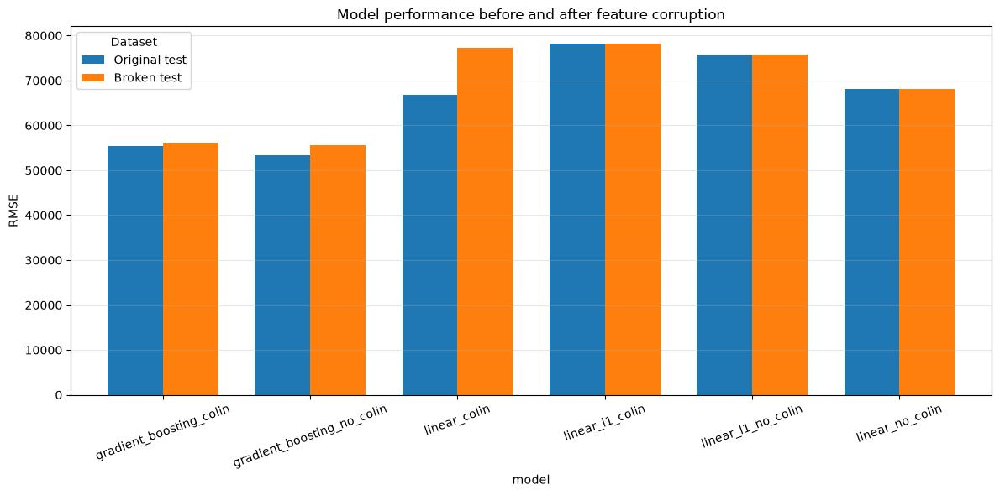
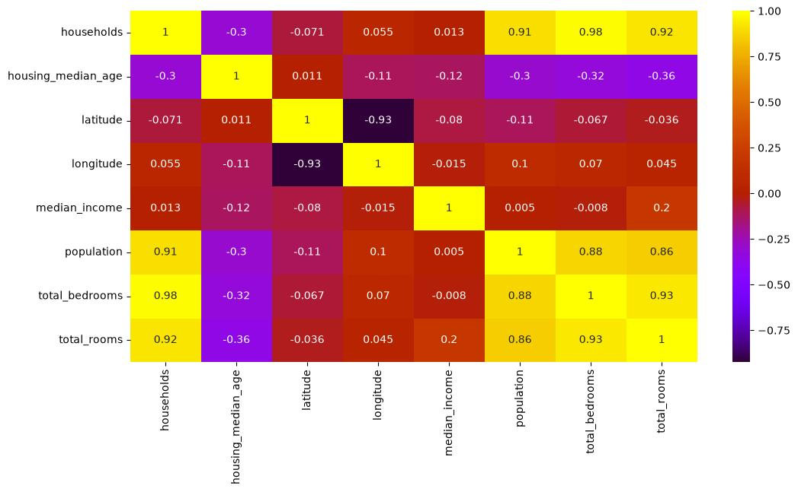
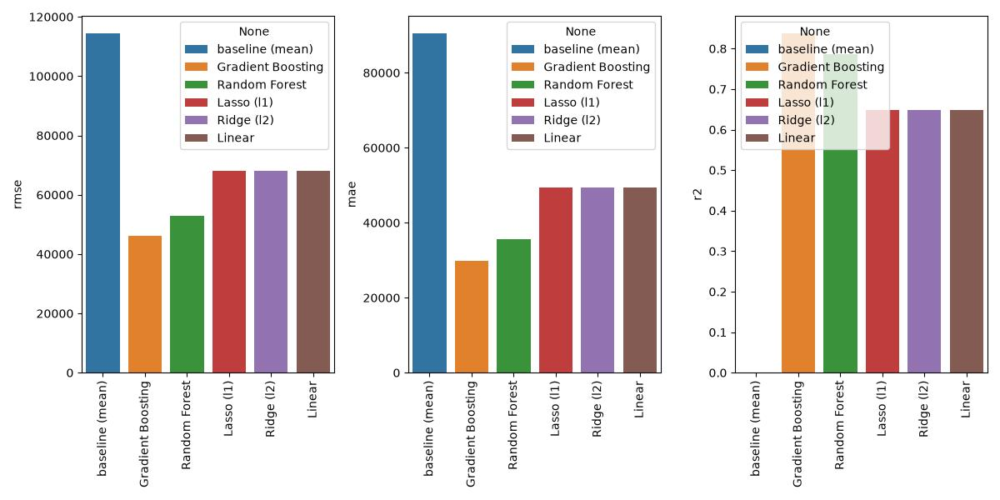
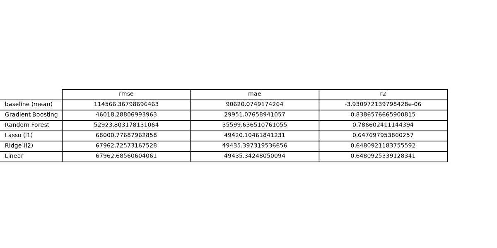

# California Housing Price Prediction

A classic machine learning project that predicts median house prices in California

**Dataset:** [California Housing Prices (Kaggle)](https://www.kaggle.com/datasets/camnugent/california-housing-prices)

## Project Structure

```
src/california_pricing/
├── main.py     # entry point: runs model selection, evaluation and describes models
├── model/      # preprocessing, model selection
└── eda.py      # visualizer for exploring the dataset (categorical features, distributions, correlations, ...)
└── discover_colinearity_issue.py      # Show how colinear features influence on model's robustness
figures/        # correlation matrix and models comparison using bar plots and tables
```

## Getting Started

The project uses the [uv](https://docs.astral.sh/uv/) package manager.

1. Install dependencies:

   ```bash
   uv sync
   ```

2. Download the dataset from Kaggle (link above) and run:

   ```bash
   uv run src/california_pricing/main --dataset-path ./path/to/dataset
   ```

### What the pipeline does

1. Compares a set of candidate models, including `sklearn.DummyRegressor` as a baseline.
2. Tunes `GradientBoostingRegressor` and `RandomForestRegressor` with `GridSearchCV` (cross-validation) and selects the best one.

## Design Decisions

All of the decisions below are based on findings from the EDA module (`src/california_pricing/eda`).

| # | Finding | Decision |
|---|---------|----------|
| 1 | `ocean_proximity` is categorical | Encoded with `OneHotEncoder`; one column is dropped to avoid collinearity. |
| 2 | `total_bedrooms` contains missing values | Imputed with the mean (`SimpleImputer`). |
| 3 | Several features are right-skewed | Logarithmic transform applied to them. |
| 4 | Some features are strongly correlated (see the correlation matrix in [`figures/`](figures/) or below) | Combined into ratio features (see `preprocess.add_ratios` in `src/california_pricing/model/preprocess.py`). This improved the robustness of the model at runtime* (see the colinearity_issue in [`figures/`](figures/) or below) |

>\* Although the gradient boosting was not influenced by the multicolinearity problem too much if it is at all. The linear regression with regularization(l1) also very robust to the multicolinearity issue

<p align="center">
  
  <br>
  <p style="text-align: center; font-size: 12px">Illustration of the multicollinearity problem. The difference in the bars height indicate the petrubation to the input vectors influence</p>
</p>

<p align="center">
  
  <br>
  <p style="text-align: center; font-size: 12px">Original correlation matrix</p>
</p>

## Results



